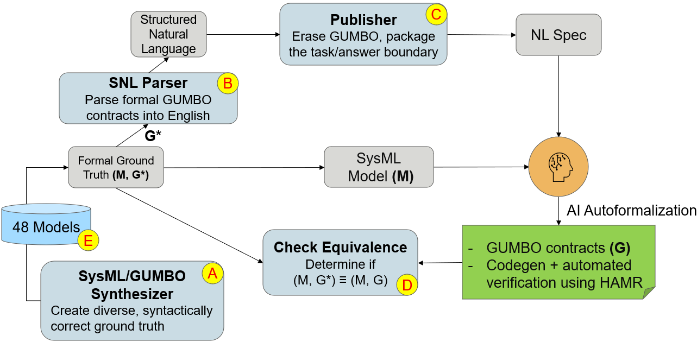

# Synthetic SysML

This repository details an approach to synthetically generate SysML V2 models for the goal of formally evaluating the task of autoformalizing GUMBO specifications.
It brings together tools for generating SysML/GUMBO ground truth, deterministically translating it into English, evaluating AI-generated contract reconstruction, and checking the result for semantic equivalence.
``sysml-viz``, a custom SysML visualization, is a tool developed as a part of this work to aide in manually inspecting the generated synthetic models.

## Ten-output reconstruction results

| Example | Reference-equivalent outputs | Weaker outputs |
| --- | ---: | ---: |
| Battery supervisor | **9/10** | 1/10 |
| Repaired HVAC supervisor | **8/10** | 2/10 |

Each row covers ten independent reconstructions with GPT-5.6-Terra/high.
These counts measure fidelity to the supplied reference contracts.
[Exact inputs, all 20 outputs, checker evidence and verification command](experiments/ensemble-10/README.md).

The figure below is the central map of the workflow.
Start with the component that matches the part of the pipeline you want to understand or change.

<em>Pipeline overview from page 30 of <a href="./docs/eoi_talk_collins.pdf" target="_blank" rel="noopener noreferrer">eoi_talk_collins.pdf</a>.</em>

## Repository map

- [`datasets/`](datasets/README.md) contains the 48 canonical benchmark instances.
- [`cps48/`](cps48/README.md) contains the campaign manifest, frozen seeds,
  diversity cards, and 48 canonical accepted runs.
- [`src/synthesizer/`](src/synthesizer/README.md) contains active generation code,
  prompts, and agent guidelines.
- [`src/snl_parser/`](src/snl_parser/README.md) contains the deterministic
  GUMBO-to-structured-English renderer and its example.
- [`src/publisher/`](src/publisher/README.md) constructs the agent-facing
  benchmark documents and contract-free models.
- [`src/equiv_checker/`](src/equiv_checker/README.md) contains the generalized
  resolved-model and GUMBO semantic equivalence checker.
- [`src/sysml_tools/`](src/sysml_tools/README.md) contains shared
  Sireum-certified GUMBO span tooling.
- [`scripts/`](scripts/README.md) contains dataset evaluation, executable
  validation, and coverage-analysis commands.
- [`experiments/`](experiments/README.md) contains the retained Rust/Verus,
  Terra-high, and Poolside benchmark campaigns and their replayable evidence.
- [`plots/`](plots/README.md) contains the joined 48-system analysis, plotting
  scripts, generated figures, and aggregate statistics.
- [`docs/`](docs/README.md) contains cross-cutting methodology and project
  presentation material.
- [`external/`](external/) contains pinned upstream Git submodules, including
  the trusted INSPECTA model examples.
- [`sysml-viz/`](sysml-viz/README.md) contains the visualization application.
- [`tests/`](tests/README.md) mirrors the active code and retains minimized
  regression fixtures.

## A. SysML Synthesizer Loop

The generator setup and experiment commands are documented in
[`src/synthesizer`](src/synthesizer/README.md); frozen campaign inputs and
canonical evidence are documented in [`cps48`](cps48/README.md).

## B. Structured Natural Language Parser

The deterministic GUMBO-to-structured-English renderer, its grammar coverage
ledger, current golden example, CLI instructions, and tests are documented in
[`src/snl_parser`](src/snl_parser/README.md).

## C. Publisher

The deterministic publisher combines selected System Abstract context with
resolved SNL, produces `N.md` and `M-star.sysml`, and applies inventory,
leakage, layout, and resolved-model gates. Its single-model and complete CPS-48
commands are documented in [`src/publisher`](src/publisher/README.md).

## D. Equivalence Checker

The generalized checker compares an oracle and candidate through Sireum's
resolved model, native GumboX predicates, and isolated Logika obligations. Its
architecture, supported semantic boundary, command line, retained evidence,
formal Isabelle specification, and tests are documented in
[`src/equiv_checker`](src/equiv_checker/README.md).

## E. Dataset

The corpus and its evaluation utilities are documented in [`datasets`](datasets/README.md).

## Experiments

The trimmed experiment archive is documented in
[`experiments/`](experiments/README.md). It retains complete HAMR codegen trees
and the exact Slang/Logika VC projects submitted by the equivalence checker.

## Plots

The complete 48-system visualization suite, its auditable joined data, figure
guide, and one-command reproduction instructions are documented in
[`plots/`](plots/README.md).

## sysml-viz

Build, server, CLI, and testing instructions are documented in
[`sysml-viz`](sysml-viz/README.md).
